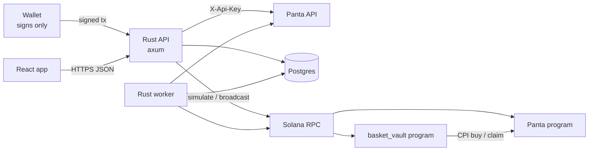

# Tenor — prediction-market baskets on Panta

> Built for the Crypto World Fair (Colosseum) — Panta side track.

Prediction markets today are single bets or all-or-nothing parlays. **Tenor sells baskets**: a
curated bundle of Panta markets around one view ("AFCON 2027: Super Eagles", "Naija Macro Mix")
bought in **one signature**. Unlike a parlay, **every leg pays on its own**, so being partly
right still pays. It feels like investing in a view, not gambling on one outcome.

Tenor runs no exchange and holds no keys: markets, liquidity and settlement are
[Panta](https://panta.market)'s, on Solana, in USDC. **Powered by Panta.**

## What's in the box

| | |
|---|---|
| **Baskets in one transaction** | Every leg's Panta buy + Tenor's fee in a single v0 transaction: all legs fill or none do. |
| **Tokenized baskets** | An Anchor program (`basket_vault`) buys the legs into a program vault and mints an SPL **basket token** priced at NAV. Panta has no sell — a token is the first way to exit a Panta position early (trade the token). |
| **Funds protection** | Every unsigned tx is validated before a wallet sees it (program allowlist, fee audit, payer check) and simulated; submit only accepts the **byte-identical** tx we built. |
| **Resolution Center** | Per-market evidence timeline, "resolving soon / delayed" lists and creator scorecards (on-time %, surprise resolutions) — clearly labelled *Tenor analysis*. |
| **Portfolio & claims** | Positions, baskets and basket tokens with P&L; "claim all" packs winning claims into as few txs as fit. |

## How we use Panta

**Through the API** (`backend/src/panta`): catalog, market detail, trade tape, positions,
`primaryorderquote → primaryorderbuild → primaryordersubmit`, claims, trade attribution
(`/trades/`). A typed client with per-family rate limits (half of Panta's budgets), retries
with backoff, and an offline mock. The API key never leaves the server.

**On chain** — we read Panta's program to build what the API cannot. Findings (all in
[`docs/panta-notes.md`](docs/panta-notes.md)):

- Program `6gM5afTQBq5VZCfgpGqcsqzfWd5maLSCKWtGjbEobZMp` is an Anchor program.
  `primary_order_usdc(side: u8, amount: u64)` takes 12 accounts; the buyer is the only signer.
- Shares are **not SPL tokens**: they live in a per-owner `UserPosition` PDA
  `["position", event, owner]`; claims write a `WinClaim` PDA `["win_claim", event, owner]`.
- **A PDA can be the buyer.** We proved it on a local validator cloning the mainnet program:
  a program signing via `invoke_signed`, paying from its off-curve USDC ATA, gets a
  `UserPosition` owned by the PDA. That is what makes tokenized baskets possible.
- There is **no slippage argument on chain** (only the API checks it) — so the vault enforces
  `min_tokens_out` itself.
- `Event` layout we rely on: YES price (1e9 scale) at offset 152; buy-window end, market end,
  resolution time and creation time at offsets 40/48/56/64.

## Architecture



- `backend/` — one Rust crate, two binaries: `api` and `worker`
  (market sync, price snapshots, basket guard, resolution watch, `tx_confirm`, `vault_crank`).
- `onchain/programs/basket_vault` — Anchor 1.1 program (create, deposit at NAV, claim, settle,
  redeem). Design: [`docs/adr/0002-tokenized-baskets.md`](docs/adr/0002-tokenized-baskets.md).
- `frontend/` — React + Vite + wallet adapter. API contract: [`docs/api.md`](docs/api.md).

### Tokenized basket pricing (NAV)

On each deposit the vault buys every leg, then values **all** holdings — old and new — at the
post-trade Panta prices. The depositor gets `supply × value_added / value_before` tokens, so
nobody is diluted by someone else's price impact. Tokens redeem pro rata for the vault's USDC
once every market has resolved and winning legs were claimed (a permissionless crank).

## Run it (no real money, no keys)

```bash
./scripts/dev-mock.sh                 # Postgres + API on :8080 with mock Panta + 3 seeded baskets
cd backend && cargo test              # 100+ unit tests (tx safety, NAV math, settlement, …)
cd backend && SMOKE_API=http://localhost:8080 cargo run --example smoke   # end-to-end API flow
```

Tokenized baskets against **Panta's real program** on a local validator (clones mainnet state;
nothing is spent):

```bash
cd onchain && anchor build
E2E_MARKET2="<event> <market authority> <market vault>" ./e2e/run.sh
```

Requires Rust stable, Docker, Solana CLI 3.x and Anchor 1.1. Copy `.env.example` →
`backend/.env` to run against the real Panta API (`PANTA_MOCK=false`).

## Status and honest limits

- Mainnet buys need real USDC; we developed against Panta's sandbox (`pk_test_`), mock mode and
  a local validator cloning mainnet. The vault program is not deployed to mainnet and is
  **unaudited** — an audit and legal review come before real users' funds.
- Panta's primary windows are short, so the two-leg vault e2e needs two markets open at once.
- `settle` is admin-triggered in v1 (ADR 0002); the next step reads resolution state on chain.

## Feedback for Panta

Things that would help integrators (details in `docs/panta-notes.md`): publish the program id
and an IDL; expose market vault authority / fee accounts on market detail; consistent time
formats (sandbox sends ISO strings, live sends unix seconds); `avgPrice` in sandbox quotes; and
a documented way for programs (PDAs) to trade and be attributed.
